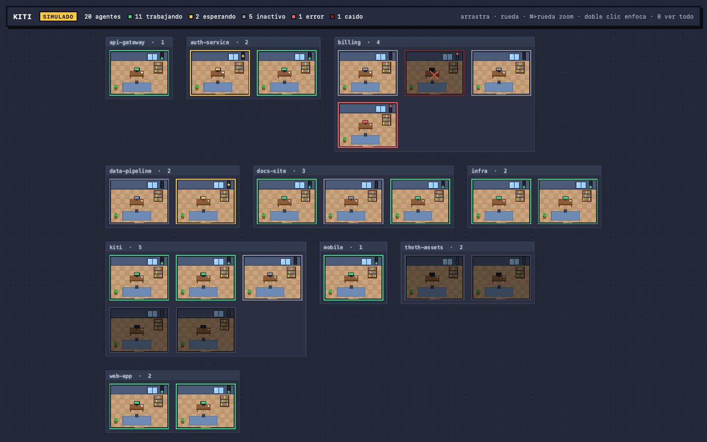
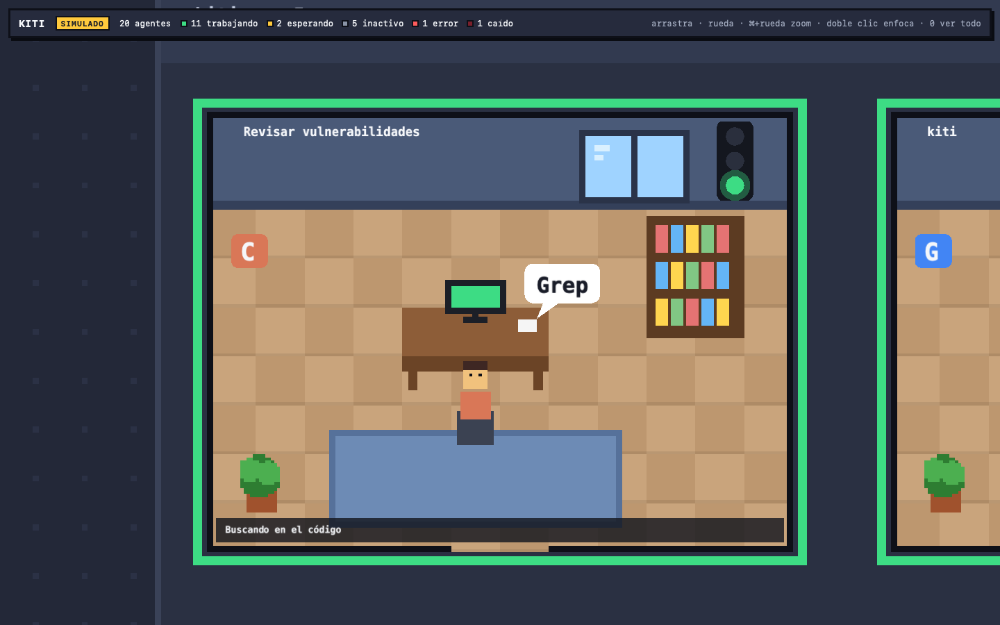
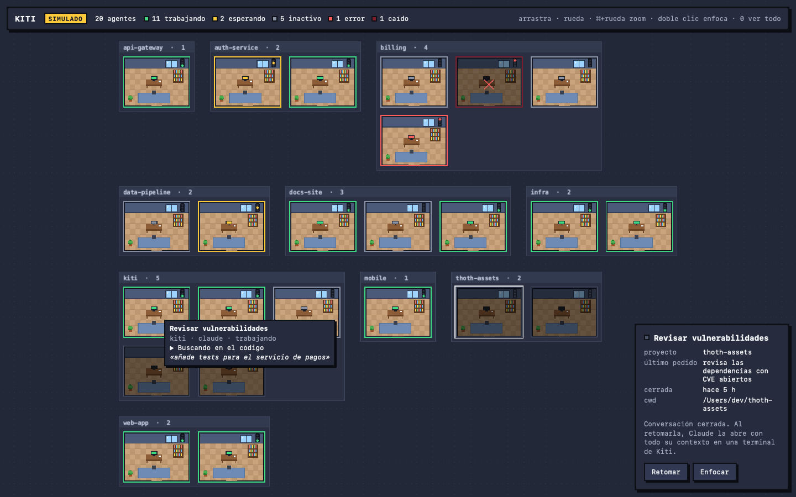

<div align="center">

# Kiti

**Una oficina virtual en pixel art donde cada sala es un agente de código que corre en tu Mac.**

Claude Code, Codex CLI y Gemini CLI en un solo mapa, con un semáforo por agente.

[](https://github.com/xavieracostapolo/kiti/actions/workflows/ci.yml)
[](LICENSE)


[**Prueba la demo**](https://xavieracostapolo.github.io/kiti/demo/) · [Web](https://xavieracostapolo.github.io/kiti/) · [Read in English](README.md)



</div>

## Por qué

Cuando tienes varios agentes de código abiertos, les pierdes la pista. Uno espera un permiso, otro terminó hace diez minutos y un tercero se cayó. Kiti vigila los agentes de tu máquina y dibuja cada uno como una oficina. Ves a todo el equipo de un vistazo y te acercas al que te necesita.

## Funciones

- **Detección automática.** Kiti encuentra los procesos de Claude Code, Codex CLI y Gemini CLI. Los clasifica por ejecutable y `argv`, nunca por el nombre del proceso, e ignora los lanzadores y las apps de escritorio.
- **Semáforo por agente.** Verde es trabajando, amarillo es esperándote, gris es inactivo y rojo es error o caída. El estado sale de los hooks de los CLIs, no de adivinar. Un fallo de herramienta no es rojo.
- **Zonas por proyecto.** Las oficinas se agrupan por raíz git (o carpeta): cada repositorio es un barrio.
- **Cámara.** Pan, zoom, doble clic para enfocar una oficina y `0` para verlo todo. De lejos ves salas y semáforos; de cerca, el título, la herramienta actual y el último pedido.
- **Terminal embebida.** Lanza un agente nuevo desde Kiti. Corre en `tmux` (`-L kiti`), así que sobrevive cuando cierras Kiti.
- **Retomar conversaciones.** Las conversaciones cerradas de Claude de los últimos 7 días quedan como oficinas apagadas. Un clic ejecuta `claude --resume` en una terminal de Kiti.
- **Barra de menú y avisos.** La barra de menú muestra los contadores. macOS te avisa cuando un agente pide permiso, termina un turno largo, falla o se cae, solo si Kiti no está al frente.
- **Cerrar una oficina.** Termina el proceso del agente tras una confirmación. Kiti verifica `(pid, start_time, uid, cmd)` antes de cada señal, así que nunca mata un PID reutilizado.

<table>
<tr>
<td></td>
<td></td>
</tr>
</table>

## Hecho para muchos agentes

El rendimiento es la prioridad número uno. El objetivo es 20 agentes o más sin coste visible.

| Medida | Resultado |
|---|---|
| CPU en reposo | 0,06 % |
| RAM en reposo | 197 MB (unos 158 MB son la base de WebKit y WebGL) |
| RAM con 20 / 50 agentes activos | 274 MB / 288 MB |
| Frames cuando nada se mueve | 0 (render bajo demanda) |

Los transcripts se leen de forma incremental desde el último offset, el core envía diffs agregados a unos 10 Hz y las oficinas fuera de cámara no se dibujan. El método está en el [ADR 0006](docs/decisiones/0006-arquitectura-consolidada/README.md#resultados-del-hito-2).

## Privacidad y seguridad

Todo se queda en tu máquina. Kiti no tiene servidor ni telemetría.

- El servidor de hooks escucha solo en `127.0.0.1` y exige un token por instalación. Comprueba `Host` y `Origin`, limita el tamaño del cuerpo y siempre responde `204`: Kiti nunca devuelve una decisión a un agente.
- Los prompts, el código y las salidas de herramientas nunca se registran ni se guardan. El título y el último pedido solo viajan del core a la UI.
- Al primer arranque, Kiti añade sus hooks HTTP a `~/.claude/settings.json` y deja intactos los tuyos. `mise run hooks:uninstall` los quita. Los hooks de Codex y Gemini son opcionales.

Para reportar vulnerabilidades, sigue [SECURITY.md](SECURITY.md).

## Primeros pasos

Kiti funciona en macOS. Windows está previsto; Linux no. Aún no hay una versión firmada, así que se compila desde el código.

### Pruébalo en el navegador

La UI funciona sin la app nativa, con agentes simulados:

```bash
git clone https://github.com/xavieracostapolo/kiti.git && cd kiti
brew install mise rustup tmux          # tmux es opcional, para sesiones persistentes
mise install && mise exec -- pnpm install
mise run ui:dev                        # http://127.0.0.1:5173/?sim=20&seed=42
```

O abre la [demo](https://xavieracostapolo.github.io/kiti/demo/). Parámetros de URL: `sim` (número de agentes), `seed`, `conversations=1` (conversaciones cerradas) y `terminals=1` (terminal falsa).

### Ejecuta la app

En Homebrew, `rustup` es *keg-only*: añade antes `/opt/homebrew/opt/rustup/bin` al `PATH`. `rust-toolchain.toml` y `mise.toml` fijan las versiones.

```bash
mise run app:dev       # app nativa con los agentes reales de esta máquina
mise run app:sim       # app nativa con 20 agentes simulados
mise run app:bundle    # genera Kiti.app y la copia al Escritorio
```

### Conecta los CLIs

| CLI | Cómo escucha Kiti | Configuración |
|---|---|---|
| Claude Code | Hooks `http` nativos y `~/.claude/sessions/<pid>.json` | Automática al primer arranque |
| Codex CLI | Hooks `command` a través del forwarder `kiti-hook` | `mise run hooks:install-codex` y luego confía en el hook en `/hooks` |
| Gemini CLI | Hooks `command` a través del forwarder `kiti-hook` | `mise run hooks:install-gemini` |

`mise run hooks:status` muestra qué está instalado. `mise run scan` muestra qué procesos ve Kiti como agentes y por qué. El forwarder falla en abierto: tiene un plazo de 150 ms, siempre sale con `0` y no hace nada si Kiti está cerrado.

## Cómo funciona

```
[claude]  --hook http----------------> [core: HookServer, 127.0.0.1]
[codex]   --hook command--> [kiti-hook] --> [core: HookServer]
[gemini]  --hook command--> [kiti-hook] --> [core: HookServer]
[procesos] --sysinfo cada 2 s--------> [core: ProcessScanner]
[~/.claude/sessions/*.json] --notify-> [core: ClaudeSessionsWatcher]
[transcripts *.jsonl] --FSEvents-----> [core: TranscriptTailer]
                                          |
                          [core: AgentRegistry + reducer del semáforo]
                                          |  diffs agregados, ~10 Hz
                          [src-tauri: tauri::ipc::Channel]
                                          |
                          [ui: store -> mundo PixiJS + paneles React]
```

| Ruta | Contenido |
|---|---|
| `crates/protocol` | DTOs compartidos, exportados a TypeScript con `ts-rs` |
| `crates/core` | Dominio, aplicación, ports y adapters en Rust puro. Sin Tauri |
| `crates/forwarder` | `kiti-hook`, el forwarder de los hooks de Codex y Gemini |
| `src-tauri` | Capa fina: commands, canal, capabilities y bandeja |
| `ui` | Vite, TypeScript y PixiJS v8 con cámara propia; React solo para paneles |
| `docs/decisiones` | Registros de decisiones de arquitectura |

Stack: Tauri v2, Rust (`tokio`, `axum`, `sysinfo`), TypeScript 7, PixiJS v8, React, zustand y xterm.js. Tests: Vitest, fast-check y Playwright en la UI; nextest, proptest e insta en Rust.

El diseño está en diez ADRs, desde la [elección del stack](docs/decisiones/0001-stack/README.md) hasta los [avisos](docs/decisiones/0010-avisos/README.md). [AGENTS.md](AGENTS.md) es la guía completa del código.

## Roadmap

- [x] Oficina simulada, shell nativo, procesos reales y hooks de los tres CLIs
- [x] Tailer de transcripts, barra de menú, terminal embebida y sesiones persistentes en `tmux`
- [x] Zonas por proyecto, conversaciones para retomar y avisos
- [ ] Soporte para Windows
- [ ] Enfocar la pestaña de Ghostty de un agente externo
- [ ] Pixel art con los tilesheets de [Kenney](https://kenney.nl)
- [ ] Versiones firmadas y notarizadas

## Contribuir

Las contribuciones son bienvenidas. Lee antes [CONTRIBUTING.md](CONTRIBUTING.md): el proyecto usa TDD y Conventional Commits.

## Licencia

[MIT](LICENSE) © 2026 Xavier Acosta Polo
