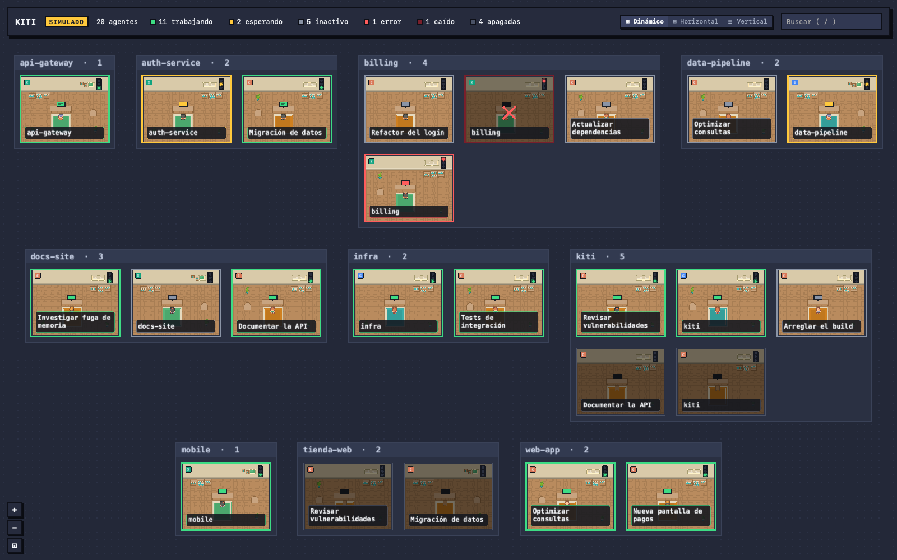
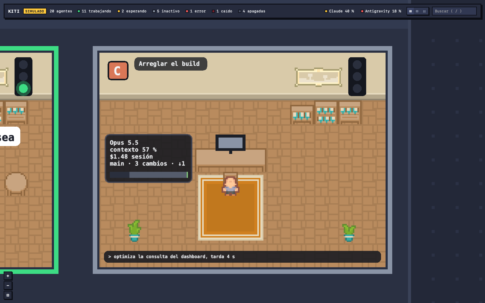
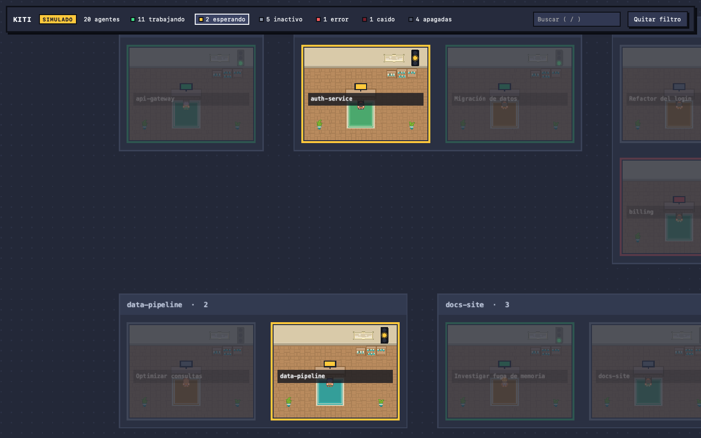
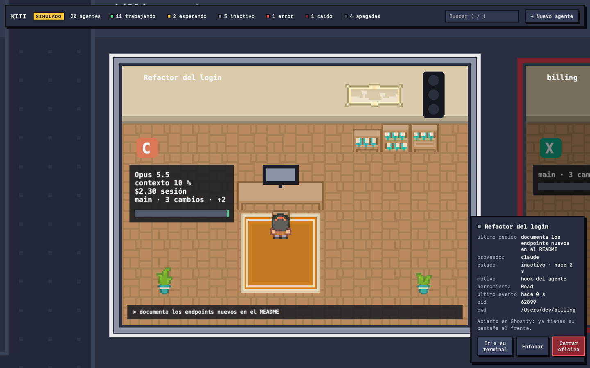
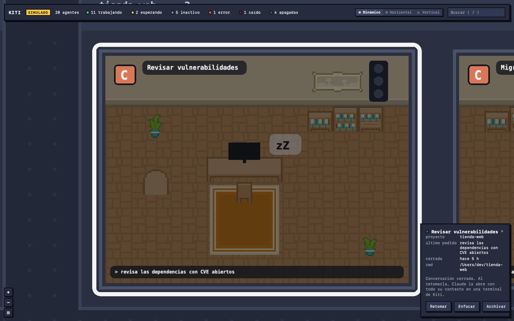

<div align="center">

# Kiti

**A pixel-art virtual office where every room is a coding agent running on your Mac.**

Claude Code, Codex CLI, Antigravity CLI and Gemini CLI in one map, with a traffic light per agent.

[](https://github.com/xavieracostapolo/kiti/actions/workflows/ci.yml)
[](LICENSE)


[**Download for macOS**](https://github.com/xavieracostapolo/kiti/releases/latest/download/Kiti_universal.dmg) · [**Try the live demo**](https://xavieracostapolo.github.io/kiti/demo/) · [Website](https://xavieracostapolo.github.io/kiti/) · [Leer en español](README.es.md)



</div>

## Why

When you run several coding agents at once, you lose track of them. One waits for a permission, another finished ten minutes ago, a third crashed. Kiti watches the agents on your machine and draws each one as an office. You see the whole team at a glance and zoom into the one that needs you.

## Features

- **Automatic detection.** Kiti finds running Claude Code, Codex CLI, Antigravity CLI (`agy`) and Gemini CLI processes. It classifies them by executable and `argv`, never by process name, and ignores launchers and the desktop apps.
- **Traffic light per agent.** Green is working, yellow is waiting for you, grey is idle, red is an error or a crash. The status comes from the CLI hooks, not from guessing. A failed tool call is not red.
- **Zones per project.** Offices are grouped by git root (or folder), so each repository is a neighbourhood.
- **Camera and layout.** Pan, zoom, double-click to focus an office, `0` to see everything, or use the `+`, `−` and fit buttons in the corner. Far away, each office shows its title on a large sign; close up you see the title, the current tool and the last request. The icons in the top bar (⊞ ⊟ ☷) switch the map between three layouts: dynamic (centered rows), horizontal and vertical. With no agents running, the map shows how to start one.
- **Alive offices.** Working agents are animated, and each office gets its own decor, so the map tells busy from idle at a glance.
- **Filter and search.** The counters in the top bar filter by status, closed conversations included. Press `/` to search by title, project, folder or provider, and `Esc` to clear. Offices that do not match are dimmed, not hidden, so the map keeps its layout and the camera frames the matches.
- **Embedded terminal.** Launch a new agent from Kiti. It runs in `tmux` (`-L kiti`), so it survives when you close Kiti. The terminal panel can be resized.
- **Jump to its terminal.** For an agent started outside Kiti, «Ir a su terminal» shows its exact tab in Ghostty or Terminal.app. Other apps, such as VS Code, are brought to the front.
- **Resume conversations.** Closed Claude conversations from the last 7 days stay as dark offices. One click runs `claude --resume` in a Kiti terminal.
- **Menu bar and notifications.** The menu bar shows the counters. macOS notifies you when an agent asks for permission, finishes a long turn, fails or crashes, but only when Kiti is not in front. Click the notification to open Kiti on that office.
- **Usage quota.** The top bar shows how much of your Claude plan (5-hour and weekly windows) and of your Antigravity quota is left, updated in real time, and Kiti notifies you once when a weekly limit drops to 20 % or less.
- **Office board.** Zoom in on an office to see the model, context used and session cost (Claude), the project's git branch, changes and commits to push or pull, and a timeline of the last hour. It only appears at the closest zoom, so the overview stays clean; the side panel shows the same data at any zoom.
- **Pixel art.** Rooms, furniture and people come from [Kenney](https://kenney.nl)'s CC0 tilesheets, drawn as a 2.5D diorama with depth and shadows. Each agent always gets the same person, and the rug takes the colour of its provider.
- **Messages between agents.** Agents of any CLI write to each other through Kiti. Kiti types each message into the recipient's terminal when it is free. A ✉ panel lists the threads, and the map shows each office's alias and an envelope travelling between offices for 3 seconds. Delivery is automatic by default; a manual mode asks you to approve each message. Limits on messages per hour and per thread stop loops. Pending messages and aliases survive a restart.
- **Project memory.** Kiti records each session's first request, touched files and task checklist from the hooks. Agents can also save decisions, gotchas and handoffs, and search them later, so context survives compaction and is shared with other agents. The memory is shared by all git worktrees of a repository and its search ignores accents.
- **Ephemeral agents.** An agent can start another one for a single task. Kiti creates a git worktree and branch for it, launches it in a Kiti terminal with a role sheet and the task, and when it reports it is done, closes it, archives its conversation and removes the worktree if that is safe. The ⚙ task board in the top bar lists each task with its role, branch, model, state and pull request. Spawning costs quota, so manual mode blocks it and Kiti caps live tasks and launches per hour.
- **Close an office.** Ends the agent process after a confirmation. Kiti checks `(pid, start_time, uid, cmd)` before each signal, so it never kills a reused PID.

<table>
<tr>
<td></td>
<td></td>
</tr>
<tr>
<td></td>
<td></td>
</tr>
</table>

## Built for many agents

Performance is the first priority. The target is 20 or more agents with no visible cost.

| Measure | Result |
|---|---|
| CPU at rest | 0.06 % |
| RAM at rest | 197 MB (about 158 MB is the WebKit and WebGL base) |
| RAM with 20 / 50 active agents | 274 MB / 288 MB |
| Frames when nothing moves | 0 (render on demand) |

Transcripts are read incrementally from the last offset, the core sends coalesced diffs at about 10 Hz, and offices outside the camera are culled. See [ADR 0006](docs/decisiones/0006-arquitectura-consolidada/README.md#resultados-del-hito-2) for the method.

## Privacy and security

Everything stays on your machine. Kiti has no server and no telemetry.

- The hook server listens on `127.0.0.1` only and needs a per-install token. It checks `Host` and `Origin`, limits the body size and always answers `204`: Kiti never sends a decision back to an agent.
- Prompts, code and tool output are never logged or saved. The title and the last request travel from the core to the UI only.
- On first start, Kiti adds its HTTP hooks to `~/.claude/settings.json` and leaves your own hooks untouched. `mise run hooks:uninstall` removes them. Hooks for Codex, Antigravity and Gemini are opt-in.
- The quota and the office board for Claude need its status line to pass through Kiti. This is opt-in: `mise run statusline:install` puts `kiti-hook` in front of your own status line command, which still prints the same output, and `mise run statusline:uninstall` restores it. Kiti keeps only the rate limits, model, context and cost from that JSON.
- If `agy` is installed, Kiti runs `agy -p /usage --output-format json` at start, after each Antigravity turn (at most every 30 s) and every 5 minutes without turns, to read the Antigravity quota. The call uses no tokens.
- Every 15 s, Kiti runs `git --no-optional-locks status` in the projects with live agents, so it never takes `index.lock` from them.

Report vulnerabilities as described in [SECURITY.md](SECURITY.md).

## Getting started

Kiti runs on macOS. Windows is planned; Linux is not.

### Download

[Download `Kiti_universal.dmg`](https://github.com/xavieracostapolo/kiti/releases/latest/download/Kiti_universal.dmg) (latest release), or pick a version in [Releases](https://github.com/xavieracostapolo/kiti/releases). It runs on Apple Silicon and Intel. Open the DMG and drag Kiti to Applications.

The release has an **ad-hoc signature**: it is not signed with an Apple Developer ID and not notarized, so macOS blocks it the first time. Open Kiti once, then click **Open Anyway** in **System Settings → Privacy & Security**. Or run:

```bash
xattr -dr com.apple.quarantine /Applications/Kiti.app
```

macOS may ask again for the Automation and notification permissions after each update. A build from source has none of these steps.

### Try it in the browser

The UI runs without the native app, with simulated agents:

```bash
git clone https://github.com/xavieracostapolo/kiti.git && cd kiti
brew install mise rustup tmux          # tmux is optional, for persistent sessions
mise install && mise exec -- pnpm install
mise run ui:dev                        # http://127.0.0.1:5173/?sim=20&seed=42
```

Or open the [live demo](https://xavieracostapolo.github.io/kiti/demo/). URL parameters: `sim` (number of agents), `seed`, `conversations=1` (closed conversations), `terminals=1` (fake terminal), `quota=1` (fake quota), `mail=1` (fake messages between agents), `tasks=1` (fake ephemeral-agent tasks), `layout=dynamic|horizontal|vertical`.

### Run the app

`rustup` is keg-only in Homebrew, so add `/opt/homebrew/opt/rustup/bin` to your `PATH` first. `rust-toolchain.toml` and `mise.toml` pin the versions.

```bash
mise run app:dev       # native app with the real agents on this machine
mise run app:sim       # native app with 20 simulated agents
mise run app:bundle    # build Kiti.app and copy it to the Desktop
```

### Connect the CLIs

| CLI | How Kiti listens | Setup |
|---|---|---|
| Claude Code | Native `http` hooks and `~/.claude/sessions/<pid>.json` | Automatic on first start |
| Codex CLI | `command` hooks through the `kiti-hook` forwarder | `mise run hooks:install-codex`, then trust the hook in `/hooks` |
| Antigravity CLI | `command` hooks through the `kiti-hook` forwarder, plus its local SQLite store for permission prompts and titles | `mise run hooks:install-antigravity` |
| Gemini CLI | `command` hooks through the `kiti-hook` forwarder | `mise run hooks:install-gemini` |

For the Claude quota and the office board, also run `mise run statusline:install` (see [Privacy and security](#privacy-and-security)).

### Let agents talk to each other

`mise run mcp:install` registers `kiti-mcp` in Claude Code, Antigravity CLI and Codex CLI (whichever are installed; `mise run mcp:uninstall` removes it). It gives each CLI seven tools:

| Tool | What it does |
|---|---|
| `kiti_agents` | Lists the running agents, with their alias, tmux session and PID |
| `kiti_send` | Sends a message to another agent |
| `kiti_inbox` | Reads the messages sent to you |
| `kiti_remember` | Saves a decision, gotcha, handoff or note in the project memory |
| `kiti_recall` | Without a query, a light index of the project; with one, the matching memories |
| `kiti_spawn` | Starts an ephemeral agent for one task, in its own worktree and branch |
| `kiti_done` | Tells Kiti an ephemeral agent finished, so Kiti can close and clean it |

You do not call these yourself: your agents do. `kiti_spawn` and `kiti_done` work like this: an agent that coordinates a job hands each piece of work to a new agent, which has its own copy of the repository and branch, so they never overwrite each other. When one finishes it opens a pull request and Kiti closes it. Merging and deleting branches stay with you. Decisions are in [ADR 0017](docs/decisiones/0017-mensajes-entre-agentes/README.md), [0018](docs/decisiones/0018-memoria-de-proyecto/README.md) and [0019](docs/decisiones/0019-agentes-efimeros/README.md).

`mise run hooks:status` shows what is installed. `mise run scan` shows which processes Kiti sees as agents, and why. The forwarder fails open: it has a 150 ms budget, always exits `0`, and does nothing when Kiti is closed.

## How it works

```
[claude]  --http hook----------------> [core: HookServer, 127.0.0.1]
[codex]   --command hook--> [kiti-hook] --> [core: HookServer]
[gemini]  --command hook--> [kiti-hook] --> [core: HookServer]
[agy]     --command hook--> [kiti-hook] --> [core: HookServer]
[processes] --sysinfo every 2 s------> [core: ProcessScanner]
[~/.claude/sessions/*.json] --notify-> [core: ClaudeSessionsWatcher]
[*.jsonl transcripts] --FSEvents-----> [core: TranscriptTailer]
                                          |
                          [core: AgentRegistry + status reducer]
                                          |  coalesced diffs, ~10 Hz
                          [src-tauri: tauri::ipc::Channel]
                                          |
                          [ui: store -> PixiJS world + React panels]
```

| Path | Content |
|---|---|
| `crates/protocol` | Shared DTOs, exported to TypeScript with `ts-rs` |
| `crates/core` | Pure Rust domain, application, ports and adapters. No Tauri |
| `crates/forwarder` | `kiti-hook`, the forwarder for Codex, Antigravity and Gemini hooks |
| `src-tauri` | Thin shell: commands, channel, capabilities, tray |
| `ui` | Vite, TypeScript and PixiJS v8 with a custom camera; React for panels only |
| `docs/decisiones` | Architecture decision records |

Stack: Tauri v2, Rust (`tokio`, `axum`, `sysinfo`), TypeScript 7, PixiJS v8, React, zustand, xterm.js. Tests: Vitest, fast-check and Playwright in the UI; nextest, proptest and insta in Rust.

The design is documented in ADRs (in Spanish), from the [stack choice](docs/decisiones/0001-stack/README.md) to [pixel art](docs/decisiones/0013-pixel-art-kenney/README.md). [AGENTS.md](AGENTS.md) is the full guide to the codebase.

## Roadmap

What changed in each version is in [CHANGELOG.md](CHANGELOG.md).


- [x] Simulated office, native shell, real processes, hooks for Claude Code, Codex and Gemini
- [x] Transcript tailer, menu bar, embedded terminal, persistent `tmux` sessions
- [x] Project zones, resumable conversations, notifications
- [x] Readable far view and office filter, focus the terminal tab of an external agent
- [x] Pixel art from [Kenney](https://kenney.nl) tilesheets
- [x] Antigravity CLI, the successor of Gemini CLI for free accounts
- [x] Downloadable universal build (ad-hoc signature)
- [x] Usage quota for Claude and Antigravity, and an office board with session, git and the last hour
- [x] Messages between agents, project memory and ephemeral agents with a task board
- [ ] Windows support
- [ ] Signed and notarized releases

## Contributing

Contributions are welcome. Read [CONTRIBUTING.md](CONTRIBUTING.md) first: the project uses test-driven development and Conventional Commits. The UI text is in Spanish for now.

## License

[MIT](LICENSE) © 2026 Xavier Acosta Polo

The office art comes from [Kenney](https://www.kenney.nl) (Roguelike RPG Pack, Roguelike Indoors and RPG Urban Pack) under [CC0](https://creativecommons.org/publicdomain/zero/1.0/). Each pack keeps its license file in [`ui/public/assets/kenney/`](ui/public/assets/kenney/).
